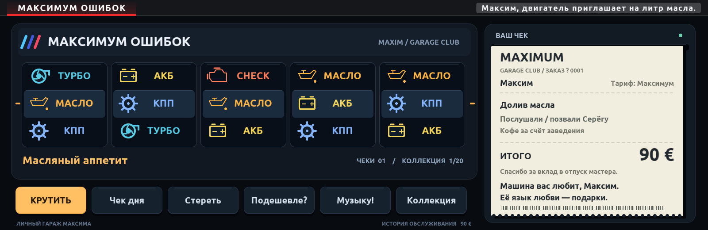

# Максимум ошибок

Персональные автомобильные слоты для Максима, BMW iDrive 7 / MGU.



Пять барабанов с автомобильными пиктограммами, 20 событий, ежедневный прогноз,
печатающийся чек и коллекция. Кнопки «Стереть», «Подешевле?» и «Музыку!» добавляют
персональные шутки. Коллекция и статистика сохраняются между запусками.

## Готовая версия 1.1.0

- [Установочный пакет .mgu](packages/maxim_errors@1.1.0.mgu)
- [Пакет .tgz](packages/maxim_errors@1.1.0.tgz)
- [Инструкция](docs/ИНСТРУКЦИЯ.txt)

Для установки нужна совместимая среда MGU с загрузчиком сторонних приложений.
Это не Android APK. Способ импорта зависит от установленного загрузчика.

## Сборка

Требуется Python 3. Из корня репозитория:

```sh
python kit/tools/build.py maxim_errors
```

Результат: `dist/maxim_errors@1.1.0.mgu` и `dist/maxim_errors@1.1.0.tgz`.
Атласы шрифтов с кириллицей уже включены.

## Управление

Касания: кнопки внизу экрана. iDrive: нажатие — вращение/быстрая остановка;
вверх — чек дня; вправо — торг; вниз — стереть; влево — выйти.
Поворот шайбы передаёт управление штатной панели кнопок.
Новое вращение блокируется при скорости выше 3 км/ч.

## Проверка

Пройдена проверка с имитацией iDrive: вращение, сохранение/повторный запуск,
касания, блокировка на ходу, чек дня, кнопки и 10 000 выборов событий.
Интерфейс отрисован и визуально проверен. На реальном MGU ещё не тестировалось.
Уведомления работают внутри игры. Реальные ошибки автомобиля не читаются и не стираются.
Все события и суммы вымышленные.

## Основа и авторство

Основано на [aurelmarius/bmw-games](https://github.com/aurelmarius/bmw-games),
Lucky Sevens, исходный коммит `8e0e82b62d3589d61a24747fcd773db99a9a8aa0`.
Модель барабанов, MGU App Kit и OAP SDK сохранены из исходного проекта.
Персональный интерфейс и сценарии находятся в `apps/maxim_errors`.
Лицензия Ubuntu Font: [Ubuntu-LICENSE.txt](kit/runtime/fonts/Ubuntu-LICENSE.txt).
Этот репозиторий не устанавливает новую лицензию на исходные сторонние компоненты.
